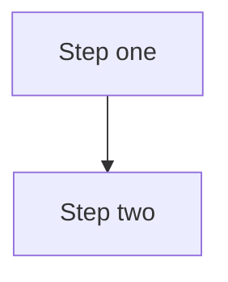

# MTConnect.NET documentation site

VitePress-based documentation site for `MTConnect.NET`, rooted at this `docs/` directory.

## Prerequisites

- Node.js 18 or newer (Node 20 LTS recommended) and `npm` (bundled with Node).
- The .NET SDK plus the `docfx` global tool (`dotnet tool install -g docfx`) — the `regen`
  prestep regenerates the API reference before every dev/build run.
- On Windows, point npm's script shell at Git Bash once, or the regen scripts resolve
  `bash` to the WSL stub and fail:

  ```bash
  npm config set script-shell "C:\Program Files\Git\bin\bash.exe"
  ```

## Local development

From this `docs/` directory:

```bash
npm ci                 # one-time install of VitePress + plugins
npm run dev            # regen, then serve at http://localhost:5173
```

The dev server hot-reloads on every save. Edit any `docs/**/*.md` and the open browser tab updates in place.

## Build a static bundle

From this `docs/` directory:

```bash
npm run build          # regen, then build → docs/.vitepress/dist/
npm run preview        # serves the built bundle at http://localhost:5173 for a final pass
```

The build output lands in `docs/.vitepress/dist/` and is excluded from version control. The generated API reference makes the bundle large (multiple GB) — relevant if you plan to ship it.

## Serving the built site alongside the agent (Docker)

The bundle is fully static (`base` defaults to `/`), so any static file server publishes it. To serve it next to the agent in a docker-compose stack on a machine that has this repository, add a service like:

```yaml
  docs:
    image: nginx:alpine
    container_name: mtconnect-docs
    restart: unless-stopped
    ports:
      - "5090:80"
    volumes:
      # adjust the relative path to where your compose file lives
      - ../../docs/.vitepress/dist:/usr/share/nginx/html:ro
```

Then `docker compose up -d docs` and browse `http://<host>:5090`. Because it is a bind mount, every `npm run build` is picked up without a container restart.

For a target machine **without** the source tree, bake the bundle into an image and ship it the same way as the agent image:

```bash
# from the repository root, after npm run build
printf 'FROM nginx:alpine\nCOPY docs/.vitepress/dist /usr/share/nginx/html\n' | docker build -t mtconnect-docs:1.0.0 -f - .
docker save -o deploy/mtconnect-docs-1.0.0.tar mtconnect-docs:1.0.0
```

On the target: `docker load -i mtconnect-docs-1.0.0.tar`, then reference `mtconnect-docs:1.0.0` from a `docs:` service (image + port mapping only, no volume) in the site's compose file.

## Mermaid diagrams

Every architecture / sequence / class-relationship / state-machine / wire-flow diagram in this site is authored in [Mermaid](https://mermaid.js.org/) — no ASCII art, no external image renders for schematic content. Mermaid is enabled via `vitepress-plugin-mermaid` (configured in `docs/.vitepress/config.ts`).

To author a diagram in any markdown page:

````markdown

````

Mermaid syntax is documented at <https://mermaid.js.org/intro/syntax-reference.html>.

## Layout

- `docs/index.md` — landing page.
- `docs/getting-started.md` — quickstart walkthrough.
- `docs/<section>/index.md` — the index page for each top-level section.
- `docs/<section>/<page>.md` — the leaf pages within a section.
- `docs/.vitepress/config.ts` — site config (nav, sidebar, Mermaid plugin, base URL).
- `docs/.vitepress/dist/` — build output (excluded from version control).

## Authoring conventions

- Internal links use site-relative paths (`/configure/agent-config`, not `../configure/agent-config.md`).
- Code samples include the target language fence (` ```csharp `, ` ```bash `, ` ```yaml `).
- External links use the full URL.
- The site is configured with `cleanUrls: true`; pages are linked without the `.md` suffix.
